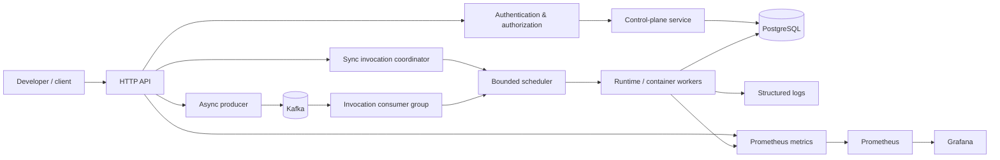
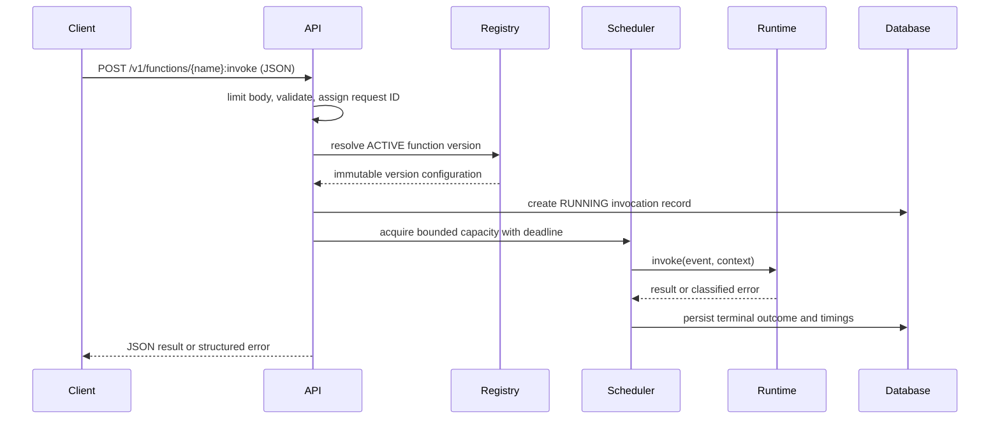

# Architecture

## Objective and requirements

### Functional requirements

1. Register functions, deploy immutable versions, select/roll back an active version, and disable a function.
2. Invoke an active or explicitly selected version synchronously with a JSON event and JSON response.
3. Accept asynchronous invocations, retry transient failures, and send exhausted messages to a dead-letter stream.
4. Execute untrusted function artifacts outside the control-plane process with configured timeout and resource limits.
5. Persist function/deployment metadata and invocation history; expose logs and operational metrics.
6. Bound per-function and global concurrency, support warm runtime reuse where safe, and shut down gracefully.

### Non-functional requirements

- Correctness: explicit state transitions, idempotent write APIs, durable invocation records, and no silent version mutation.
- Reliability: bounded queues/retries/resources, restart recovery, useful failure classification, and graceful dependency degradation.
- Security: authenticated control plane, authorization, input-size limits, secret redaction, least-privilege containers, and artifact provenance.
- Operability: JSON structured logs, correlation IDs, Prometheus metrics, health/readiness checks, dashboards, and runbooks.
- Performance: measure actual p50/p95/p99, cold-start versus handler time, queue wait, worker utilization, and resource use.

## Boundaries: control plane and data plane

The **control plane** owns metadata: functions, versions, policies, deployment state, and authorization. The **data plane** accepts and schedules invocation work, records outcomes, and eventually asks an isolated runtime to execute. Keeping execution out of the API/control-plane process limits blast radius and permits independent scaling.



In Phase 1, `Runtime / container workers` is temporarily represented by trusted built-in Go handlers behind the same runtime interface. PostgreSQL is introduced for the registry, but no user artifact executes yet.

## Invocation lifecycle

Synchronous request flow:



Async flow differs after validation: the API creates an invocation in `QUEUED`, publishes a message containing only `invocation_id`, and returns `202`. A durable consumer claims the record, runs it, stores the terminal outcome, and acknowledges only after that durable transition. Redelivery may happen, so execution is at-least-once.

## State machines

Function lifecycle: `CREATED -> DEPLOYING -> ACTIVE`; deployment validation/startup failure gives `FAILED`; an operator can transition `ACTIVE|FAILED -> DISABLED`; a new deployment transitions an active function through `DEPLOYING` while the previous active version remains invokable until atomic activation. `DISABLED` rejects new invocations. Function state describes availability; version state describes artifact readiness.

Version lifecycle: `PENDING -> VALIDATING -> ACTIVE` or `FAILED`; an older `ACTIVE` version can become `RETIRED` but remains immutable and addressable while retained.

Invocation lifecycle: `ACCEPTED -> QUEUED` (async) or `RUNNING` (sync), then exactly one terminal state: `SUCCEEDED`, `FUNCTION_ERROR`, `TIMED_OUT`, `CANCELLED`, or `INFRASTRUCTURE_ERROR`. An async retry changes `RETRY_SCHEDULED -> QUEUED` with an incremented attempt. A terminal exhausted invocation enters `DEAD_LETTERED` after the database outcome and DLQ publication are both durably reconciled.

## Execution and worker lifecycle

An execution environment is a process/container initialized with a function artifact and runtime adapter. Initialization includes image/container start and runtime handshake; handler execution begins only after initialization. A worker moves `PROVISIONING -> IDLE -> BUSY -> IDLE`, then `DRAINING -> TERMINATED`; unrecoverable startup or process failure yields `FAILED`. The scheduler owns these transitions, applies global/per-function semaphores, and never creates unbounded goroutines or containers.

Docker provides process/resource isolation, but it is weaker than a purpose-built sandbox. Containers run non-root, without privileged mode or Docker socket access, with restricted capabilities, read-only root filesystem where practical, memory/CPU/pid limits, and limited networking. Stronger isolation (microVMs/gVisor) is deferred and documented as an option, not claimed.

## Package boundaries (target structure)

```
cmd/aetherbolt/       composition root; config and HTTP server lifecycle
internal/httpapi/     routing, decoding, response/error mapping, request IDs
internal/function/    function/version domain types and service
internal/invocation/  lifecycle, coordinator, idempotency, scheduling contracts
internal/runtime/     Runtime interface; later Docker implementation
internal/worker/      bounded workers, warm reuse, graceful drain
internal/store/       repository interfaces and PostgreSQL implementations
internal/queue/       publisher/consumer interfaces and Kafka adapter
internal/observability/ logging, metrics, health checks
internal/auth/        later authentication/authorization boundary
migrations/           ordered SQL migrations
```

The HTTP layer must depend on application services, not SQL or Docker directly. Runtime and queue adapters implement small domain-owned interfaces, so Phase 1 built-ins can be replaced without changing endpoint semantics.

## Scaling and known limits

Initial scaling is single-host and deliberately bounded by configured global/per-function concurrency and queue capacity. Signals for later autoscaling are queue depth, active workers, latency, and idle time; hysteresis/cooldowns prevent oscillation. PostgreSQL invocation history will become a write bottleneck at high rates, and a single Kafka/Docker host is not highly available. Those constraints are acceptable for a local portfolio platform and must be visible in operations documentation.
