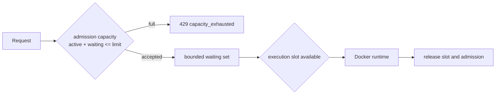

# Execution and scheduling (Phases 2–3)

## Objective

Phase 2 adds a real Docker execution boundary; Phase 3 adds bounded admission and graceful draining around that boundary. The API process never executes container-function code itself. Built-in handlers remain only as trusted Phase 1 fixtures.

## Container execution contract

The image entrypoint receives exactly one JSON event on standard input and must emit exactly one JSON object to standard output:

```json
{"result":{"any":"valid JSON"},"handler_duration_ms":4}
```

Non-zero exit status is a `function_error`; malformed output is also a function error. A missing image, unavailable daemon, or failed container startup is a `runtime_unavailable` error. A deadline is a `invocation_timed_out` error. Standard output and standard error are capped at 1 MiB and are not returned or logged by default.

The sample [echo function](../examples/functions/echo/) is a local, pre-built image. Phase 2 accepts only local `aetherbolt-function-*` references and uses Docker `--pull never`; image upload, remote registries, signatures, and immutable deploy versions are Phase 5 work.

For a per-invocation process, total container elapsed time minus the contract-reported handler duration is recorded as initialization time. Every container invocation is therefore a cold start. This is a useful, explicit approximation—not a claim that the Docker CLI exposes a Lambda-equivalent lifecycle signal.

## Container security baseline

The runtime uses a generated container name and `--rm`. On cancellation or deadline it also issues `docker rm -f` to prevent a detached/orphaned workload. Each invocation applies:

- `--network none`, `--read-only`, a restricted `/tmp` tmpfs, numeric non-root user `65532:65532`, and `--cap-drop ALL`;
- `no-new-privileges`, init process, PID limit 64, configured memory limit, CPU quota, and no image pull;
- no privileged mode, host mounts, Docker socket mount, environment-secret injection, or host networking.

These controls reduce blast radius but do not make Docker a complete hostile-code sandbox. A production multi-tenant platform would require image provenance, policy enforcement, kernel hardening, egress policy, stronger isolation such as microVMs/gVisor, and security review.

## Scheduler behavior

`worker.Manager` has two bounded channels:



`max_concurrent` limits active container runs. `queue_capacity` limits waiting work; total admitted work is their sum. There is no unbounded goroutine, container, or queue creation. Request context cancellation applies while waiting and during execution. On shutdown, admission closes first (`503 service_draining` for later requests), HTTP shutdown waits for active requests, and the scheduler waits for admitted work until its shutdown deadline.

Warm containers are deliberately not reused yet. A semaphore scheduler is the appropriate Phase 3 primitive because the Docker process is created per invocation. A persistent worker/container pool adds lifecycle state, affinity, and cleanup complexity and is deferred to Phase 6.

## Test strategy

- Runtime unit tests assert security-sensitive Docker arguments, response decoding, deadline classification, and Docker/startup versus function-error classification.
- Scheduler tests fill the bounded admission set, prove overload returns `ErrCapacity`, and prove draining rejects new work while allowing admitted work to finish.
- Run `go test ./...`, `go test -race ./...`, and `go vet ./...`. The live container smoke test is documented in the README and verifies Docker enforcement, not merely a mocked command runner.
